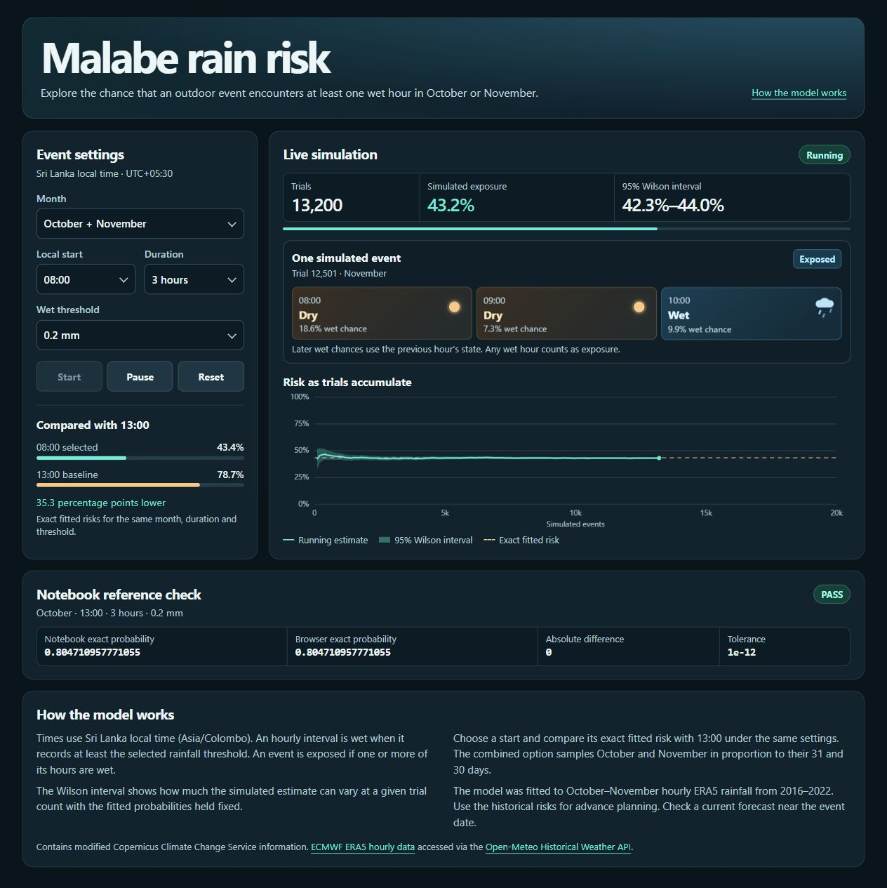
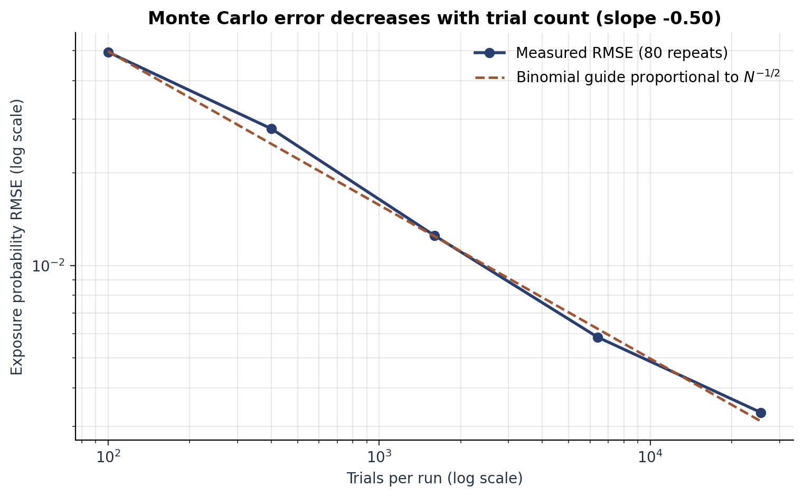

# Rain-risk planning in Malabe

Compare October and November start times for an outdoor event in Malabe using hourly rainfall estimates and an interactive simulator.

**[Live demo](https://kumaragekpv.github.io/malabe-rain-risk/)** · [](https://colab.research.google.com/github/KumarageKPV/malabe-rain-risk/blob/main/notebook/malabe-rain-risk.ipynb)



## The question

For a three-hour outdoor event in Malabe in October or November, which hourly start from 08:00 through 15:00 gives the lowest chance of encountering at least one hour with 0.2 mm of rain or more? The comparison uses 13:00 as the baseline. All times are Sri Lanka local time.

## Quick start

1. **Notebook on Colab.** Open the badge above and select **Runtime → Run all** on a CPU runtime. The notebook installs its Python dependencies, reads the [commit-pinned rainfall snapshot](https://raw.githubusercontent.com/KumarageKPV/malabe-rain-risk/d65be4337dbf0b4e4f3f4a1722f9fc90897a5d26/data/malabe_era5_hourly_utc.csv), and writes tables and plots under `exports/`. No data upload or API key is needed.
2. **Browser demo.** Open the live demo, or download this repository and open `docs/index.html` with its adjacent files in place. The browser loads the fitted probabilities from a local script.
3. **Notebook on your computer.** Download or clone the repository, then run the commands below from its root using Python 3.12. Open the notebook in Jupyter and run all cells in order. The local copy of the dataset is detected automatically.

```bash
python -m pip install -r requirements.txt notebook
python -m notebook notebook/malabe-rain-risk.ipynb
```

Verified in a clean Python 3.12 kernel with NumPy 2.5.5, pandas 3.1.1 and Matplotlib 3.11.2. The run loaded the pinned CSV and reproduced the notebook checks and browser probability tables.

## Using the demo

Choose a month, start, duration and wet threshold. Press **Start** to see an example event’s hourly wet and dry states, with animated rain on wet hours. The running estimate and 95% Wilson interval summarise all trials. Press **Pause** to inspect the displayed event or **Resume** to continue. The event settings panel compares the exact fitted risks at your selected start and at 13:00. [User guide and labelled screenshot](USER_GUIDE.md).

## Model and mathematics

The first hour uses its fitted wet frequency. For each later hour, a first-order Markov chain uses the previous state and the transition probabilities for the destination hour and month. The exact event risk is one minus the probability of an all-dry sequence. The notebook also computes an independent-hour comparison from the same fitted hourly frequencies. [Theory, equations and assumptions](THEORY.md).

## Verification

All **17 notebook checks passed**, including the toy exact risk of 0.552 and an exact-versus-simulated check on real fitted data. For the October 13:00 reference over three hours at 0.2 mm, the notebook and demo both returned **0.804710957771055** with an absolute difference of **0** against a tolerance of **1e-12**. [Verification table](exports/verification_checks.csv).



## Concepts applied

- **Markov chains.** Wet and dry states let the model account for the tendency of rainfall to persist from one hour to the next.
- **Estimation from rainfall records.** Local hourly totals yield wet frequencies for the opening hour and transition counts for later hours, grouped by month and hour.
- **Monte Carlo simulation.** Repeated simulated events estimate exposure by the fraction of trials with any wet hour. Wilson intervals quantify variation due to finite trial counts with the fitted probabilities held fixed.

## Results

For the default combined October–November scenario, **08:00 had the lowest fitted risk at 43.4%, compared with 78.7% at 13:00**. The estimated reduction was **35.3 percentage points**, with a 95% season-bootstrap interval of **23.8–48.6 points**. In the 2023–2025 holdout, 08:00 was exposed on 93 of 183 valid dates (50.8%) and 13:00 on 145 (79.2%). The Markov model had the lower pooled Brier score, 0.206 versus 0.225 for independent hours. [Risk by start](figures/main_risk_by_start.png) · [Held-out comparison](figures/x4_heldout_comparison.png).

The notebook also compares four durations, four thresholds and three ways to align the source hours. Threshold had the largest average effect over the settings tested. [Sensitivity figure](figures/x5_sensitivity.png) · [Timing comparison](exports/x5_timing_sensitivity.csv) · [Bootstrap figure](figures/x5_bootstrap_intervals.png).

## Limitations

The estimates reflect historical patterns from one ERA5 grid cell and seven training seasons. Half-hour alignment assumes rainfall is uniform within each source hour, so short bursts can be smoothed. The model uses month, hour and the previous wet/dry state. For a specific event date, use a current forecast alongside these historical estimates.

## Key references

- ECMWF's hourly ERA5 dataset and the reanalysis method. [Data catalogue](https://doi.org/10.24381/cds.adbb2d47) · [Hersbach et al.](https://doi.org/10.1002/qj.3803).
- Open-Meteo's historical API and precipitation timestamp convention. [API documentation](https://open-meteo.com/en/docs/historical-weather-api#hourly-parameter-definition).
- Weather-state models and binomial score intervals. [Wilks and Wilby](https://doi.org/10.1177/030913339902300302) · [Wilson](https://doi.org/10.1080/01621459.1927.10502953).

[Full references](REFERENCES.md).

## AI assistance

AI assisted with code and documentation. Checks and experiment outputs are available in the notebook and accompanying tables.

## Licence and data credits

Project code is released under the [MIT License](LICENSE). The rainfall data are licensed separately under [CC BY 4.0](https://creativecommons.org/licenses/by/4.0/).

Contains modified Copernicus Climate Change Service information from ECMWF ERA5, accessed via Open-Meteo. The representative town point comes from OpenStreetMap contributors. [Data provenance, transformations and attribution](data/README.md).
