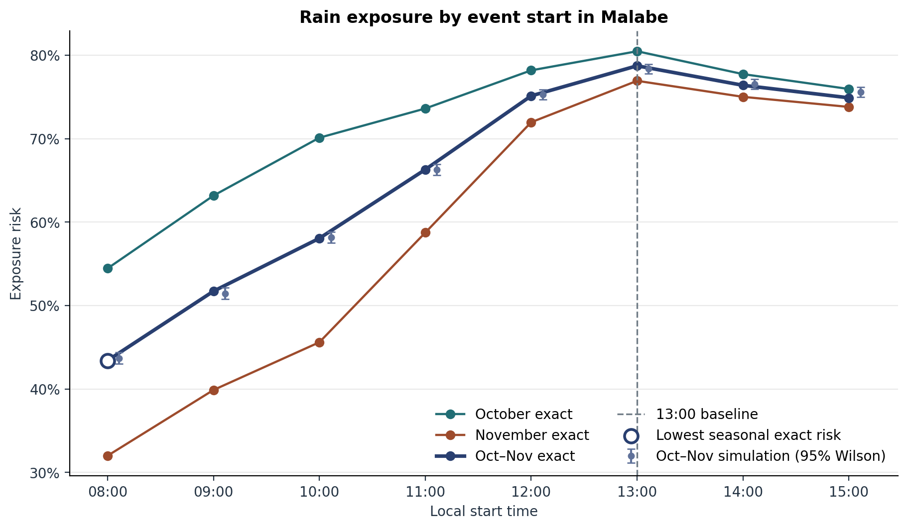

# Theory and mathematics

## 1. Problem formulation

The model estimates rain exposure for an outdoor event in Malabe during October or November. It considers local starts from 08:00 through 15:00, durations of one to four hours and wet thresholds of 0.1, 0.2, 0.5 and 1.0 mm per hour. The default event lasts three hours and uses 0.2 mm. An event is exposed if any hourly interval reaches its threshold. The baseline starts at 13:00 under the same month, duration and threshold.

## 2. Assumptions

1. **Representative location.** The ERA5 grid cell returned for the Malabe town point represents its surrounding area. Fit on the 2016–2022 seasons and reserve 2023–2025 for evaluation. [Source and processing](data/README.md).
2. **Hour alignment.** Source totals are for the hour preceding each UTC timestamp. In Asia/Colombo (UTC+05:30) source bins end on the half-hour. Each whole local event hour uses half of each of its two overlapping source totals. Both must be valid and adjacent.
3. **Wet or dry.** Keep valid hours with rainfall at or above the selected threshold as wet and the rest as dry. Exclude unknown hours from the fit and exclude incomplete event windows from held-out scoring.
4. **Conditional persistence.** The next hour's state depends on month, destination clock hour and the previous state. Use only consecutive valid hours on the same local date for transition counts. A higher-order model could use more past states or contextual variables.
5. **Month weights.** For a uniform date within the combined season, use weights of 31/61 for October and 30/61 for November. Draw one month per simulated event and use it for all hours of that event.

## 3. Model equations

| Symbol | Meaning | Units or values |
|---|---|---|
| $m$ | Local calendar month | 10 (October) or 11 (November) |
| $h$, $s$ | Local interval start hour and event start hour | $s$ is 8–15. Event intervals may start up to hour 18. |
| $d$ | Event duration | 1–4 hours |
| $\tau$, $r_{m,t}$ | Wet threshold and estimated rainfall in the local hour starting at time $t$ | Millimetres accumulated in one hour |
| $X_t$, $E$ | Wet/dry state at time $t$ and event exposure indicator | 0 or 1 |
| $q_{m,h}$ | Marginal wet probability, used for the opening hour | 0–1 |
| $N_{m,h,i,j}$ | Number of valid transitions from state $i$ to state $j$ ending at hour index $h$ | Count of adjacent hour pairs |
| $T_{m,h}(i,j)$ | Smoothed transition probability into the interval starting at $h$ | 0–1 |

The threshold indexes a separate fit in every equation below. Let $a_t$ and $b_t$ be the source totals for the one-hour bins ending 30 and 90 minutes after $t$, respectively. Both overlap the local event interval $[t,t+1)$ by 30 minutes. The two-bin average estimates the local total.

$$
r_{m,t}=\tfrac{1}{2}(a_t+b_t),\qquad X_t=\mathbf{1}[r_{m,t}\ge\tau],\qquad E=\max_{k=0,\ldots,d-1}X_{s+k}.
$$

If $n_{m,h}$ counts valid intervals and $n^{\mathrm{wet}}_{m,h}$ counts wet ones, fit the initial probability and the transition matrix as follows.

$$
q_{m,h}=\frac{n^{\mathrm{wet}}_{m,h}}{n_{m,h}},\qquad
T_{m,h}(i,j)=\frac{N_{m,h,i,j}+0.5}{N_{m,h,i,0}+N_{m,h,i,1}+1}.
$$

Each transition row sums to one. The 0.5 pseudo-count in each cell stabilises sparse rows. A previous-state row with zero pairs yields probabilities of 0.5 and 0.5 and is flagged as having zero direct evidence. The group $h=9$ contains intervals starting at 09:00 preceded by intervals starting at 08:00.

Taking the complement of the all-dry path gives the exact fitted risk for the Markov model. The independent-hour comparison instead uses the marginal wet frequency in every hour.

$$
p_{\mathrm{M}}(m,s,d)=1-(1-q_{m,s})\prod_{k=1}^{d-1}T_{m,s+k}(0,0)
$$

$$
p_{\mathrm{I}}(m,s,d)=1-\prod_{k=0}^{d-1}(1-q_{m,s+k}).
$$

For a one-hour event both probabilities are $q_{m,s}$. Both combined-season risks are weighted means of the monthly risks, $p_{\mathrm{Oct–Nov}}=\tfrac{31}{61}p_{\mathrm{Oct}}+\tfrac{30}{61}p_{\mathrm{Nov}}$. Compute percentage points of risk avoided by subtracting the selected start's fitted risk from the 13:00 fitted risk and multiplying by 100.

## 4. Numerical method

At a one-hour time step, compare independent uniform draws with $q_{m,s}$ for the first state and $T_{m,s+k}(X_{s+k-1},1)$ for each following state. Mark a trial exposed once any state is wet. For $K$ exposed trials out of $N$, the estimated risk is $\hat p=K/N$. The notebook uses 20,000 trials per main scenario and independent seeded streams for the main comparison, error experiment, and resampling.

For a 95% Wilson interval use $z=1.959964$, $D=1+z^2/N$, a centre $c$, and half-width $w$. Clamp the endpoints to $[0,1]$ against rounding. This measures uncertainty from simulating $N$ events with fixed fitted probabilities. [Wilson, reference 6](REFERENCES.md).

$$
c=\frac{\hat p+z^2/(2N)}{D},\qquad
w=\frac{z}{D}\sqrt{\frac{\hat p(1-\hat p)}{N}+\frac{z^2}{4N^2}}.
$$

### Experiment evidence

- **X2 · Monte Carlo convergence.** A Bernoulli Monte Carlo estimator has theoretical RMSE $\sqrt{p(1-p)/N}$ around the exact fitted risk $p$. Using 80 independent repeats at each of five trial sizes from 100 to 25,600, the fitted log–log RMSE slope was −0.502. [Error-scaling figure](figures/x2_mc_error_scaling.png) · [RMSE table](exports/x2_mc_error_scaling.csv).
- **X4 · Held-out comparison.** At the default threshold and duration, compare Markov and independent-hour probabilities with binary outcomes at each eligible start on 2023–2025 dates. The Brier score is the mean of $(p_i-E_i)^2$ over complete windows, with smaller values indicating lower error. Across 1,464 windows, the Markov model scored 0.2058 and independent hours 0.2252. In November alone independent hours scored slightly lower, 0.2022 versus 0.2054. Windows on the same date overlap. [Held-out comparison figure](figures/x4_heldout_comparison.png) · [Brier scores](exports/x4_brier_scores.csv) · [Window counts and risks by start](exports/x4_heldout_comparison.csv).
- **X5 · Sensitivity.** Evaluate all 384 combinations of reporting period, start, duration and threshold. The average risk span when changing one factor at a time was 46.4 percentage points for threshold, 34.1 for start and 22.4 for duration. For the default event, the selected start remained 08:00 under both half-hour shifts on the same 427 training dates. Its combined risk ranged from 43.4% to 59.0% across alignments. [Sensitivity figure](figures/x5_sensitivity.png) · [Scenario sweep](exports/x5_sensitivity.csv) · [Time alignment](exports/x5_timing_sensitivity.csv).
- **X5 · Fit uncertainty.** Resample the seven training seasons as whole blocks, with replacement, in 500 replicates. Refit the initial and transition probabilities and take the 2.5th and 97.5th percentiles of the exact risks and baseline differences. The default 08:00 risk was 43.4% with a 32.7–53.6% bootstrap interval. The reduction versus 13:00 was 35.3 percentage points with a 23.8–48.6-point interval. [Bootstrap figure](figures/x5_bootstrap_intervals.png) · [Intervals](exports/x5_bootstrap_intervals.csv) · [Season draws](exports/x5_bootstrap_draws.csv).

## 5. Verification

All 17 notebook checks passed. These checks cover alignment, fitting, probability arithmetic, limits of the simulator and agreement on fitted data. The separate browser reference checks that the published page evaluates the same scenario from the exported probabilities. [Full notebook check table with tolerances](exports/verification_checks.csv).

| Check | Expected | Obtained | Result |
|---|---|---|---|
| Shared years between fitting and evaluation | 0 | 0 | PASS |
| Combined month weights | 1 | 1 | PASS |
| Toy source bins and threshold | 08:00 local, 0.20 mm, wet | 08:00 local, 0.20 mm, wet | PASS |
| Toy gaps and missing totals | Unknown | Unknown | PASS |
| Fitted probabilities and row sums | All in [0, 1], every transition row sums to 1 | In range, maximum row-sum error 0 | PASS |
| Transitions in a three-hour event | 2 | 2 | PASS |
| October 09:00 dry → wet at 0.2 mm | $(28+0.5)/(124+28+1)$ | 0.18627450980392157 | PASS |
| Toy three-hour exposure | $1-0.8\cdot0.8\cdot0.7=0.552$ | 0.552 (rounded) | PASS |
| Toy one-hour exposure | 0.2 | 0.2 (rounded) | PASS |
| Deterministic trials | 0/64 exposed if all dry, 64/64 if always wet | 0/64 and 64/64 | PASS |
| Seeded trace and vectorised one-trial batch | Same exposure flag | Both 1 | PASS |
| October 08:00, 3 hours, 0.2 mm | 0.54442978 exact, error at most 0.01150904 | 0.54275 over 20,000 trials, error 0.00167978 | PASS |
| Browser reference, October 13:00, 3 hours, 0.2 mm | 0.804710957771055, absolute error at most `1e-12` | 0.804710957771055, absolute error 0 | PASS |

## 6. Concepts applied

| Concept | Application |
|---|---|
| First-order Markov chains | Estimate wet/dry persistence with separate transition probabilities after wet and dry hours. Compare predictions with an independent-hour model fitted to the same records. |
| Data preparation and parameter estimation | Convert UTC accumulations to local event intervals, label wetness at each threshold, then fit the counts of wet hours and consecutive states by month and clock hour. |
| Monte Carlo simulation | Draw wet/dry paths, estimate exposure by the fraction with at least one wet hour, check against the all-dry path calculation, and measure how error decays as trials increase. |
| Held-out evaluation and block bootstrap | Score historical-risk predictions on later seasons and assess fit uncertainty by keeping each resampled training season together. |

## 7. References

The notes in [REFERENCES.md](REFERENCES.md) give the ERA5 catalogue, timestamp convention, stochastic weather models, Wilson interval, proper scoring rules and block-resampling background.
