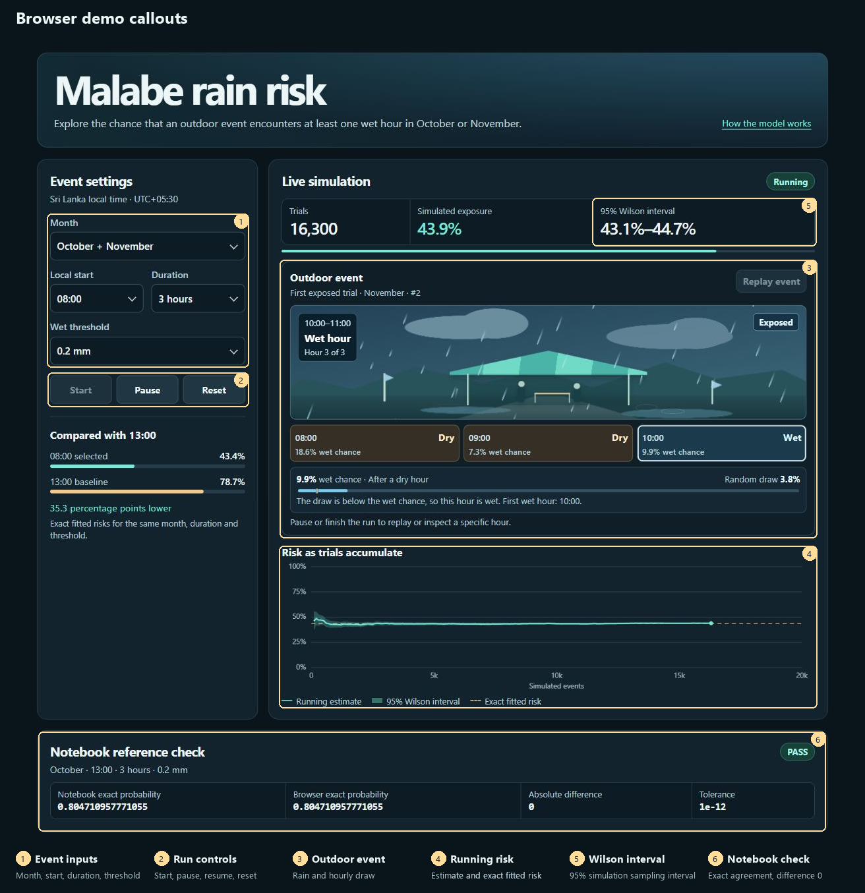

# Malabe rain-risk demo user guide

Open the [live demo](https://kumaragekpv.github.io/malabe-rain-risk/). To open it from a downloaded copy, keep all files in `docs/` together and open `docs/index.html` in a current browser. Simulation uses the fitted values shipped with the page and requires no account or live API.

## Controls

| Control | What it does | Available values | Default |
|---|---|---|---|
| Month | Chooses the fitted rainfall pattern. The combined option draws October for 31 of every 61 events on average and November for the other 30. | October, November, October + November | October + November |
| Local start | Sets the start on the Sri Lanka clock (Asia/Colombo, UTC+05:30). | 08:00 through 15:00, at one-hour steps | 08:00 |
| Duration | Sets the number of consecutive one-hour intervals. A three-hour event starting at 08:00 ends at 11:00. | 1, 2, 3 or 4 hours | 3 hours |
| Wet threshold | An interval is wet when its estimated total is at least this many millimetres. | 0.1, 0.2, 0.5 or 1.0 mm | 0.2 mm |
| Start / Resume | Runs batches of events. After pausing, Resume continues from the saved count. | Up to 20,000 trials per run | Ready, zero trials |
| Pause | Freezes the sample and stops adding trials. | Available during a run | Disabled before Start |
| Reset | Clears results and keeps the current settings. | Available once a run starts | Disabled before Start |
| Replay event | Plays the same outdoor event again. | While paused or after completion | Disabled before Start |
| Hour cards | Select an hour to see its weather, fitted wet chance, and random draw. | One card per event hour, while paused or after completion | Disabled before Start |

Changing any event setting clears the existing trials. Press **Start** to simulate the new scenario.

## Reading the outputs

- **Trials** and the progress bar show how many of the 20,000 events have been simulated so far.
- **Outdoor event** plays an actual trial from the opening batch. It uses the first exposed trial in that batch when available, or the first dry trial if the batch is all dry. The scene advances through the event hours as the trial count grows. The last hour remains active until the run completes. Wet hours show rain, roof runoff and puddle ripples. The decision strip compares the random draw with the fitted wet chance. A draw below that chance is wet. The panel shows whether a wet hour has occurred yet. Pause or finish to replay or inspect an hour. Reduced-motion settings show still weather details.
- **Simulated exposure** is the percentage of events exposed. The teal line tracks that estimate as trial count grows.
- **95% Wilson interval** appears in the readout and as shading around the running estimate. It describes sampling variation with the fitted model held fixed. More trials usually narrow the interval.
- **Exact fitted risk** is the dashed line. It comes from multiplying the dry-state probabilities, so it stays fixed for the current settings. The comparison panel shows the selected hour, the 13:00 baseline, and their difference in percentage points.
- **Notebook reference check** evaluates the fixed scenario below at every page load. Its **PASS** badge is independent of the simulated trial count.

### Why repeated runs differ

Each fresh run uses new random draws. The example event, simulated exposure percentage and Wilson interval can vary with identical settings. The exact fitted risk and 13:00 comparison stay the same for those settings. With the default settings and 20,000 trials, the simulated percentage will usually be within about 0.7 percentage points of the 43.4% fitted risk.

## Try this comparison

Keep October + November, three hours and 0.2 mm. With **08:00** selected, the exact fitted risks are **43.4% at 08:00** and **78.7% at 13:00**, a difference of **35.3 percentage points**. Press **Start** and watch the estimate approach the 08:00 fitted value. Pause or wait for the run to finish, then select an hour or replay the scene to see which hours led to the exposure result. Change the start to **13:00** to clear the old trials, then press **Start** again and compare the new result.

## Check against the notebook

| Fixed reference input or result | Value |
|---|---|
| Month, start, duration and threshold | October, 13:00, 3 hours, 0.2 mm |
| Exact notebook probability | `0.804710957771055` |
| Exact browser probability in the verified run | `0.804710957771055` |
| Absolute difference and tolerance | `0` and `1e-12` |

The browser recomputes the probability from the exported fit tables. The check passes when the absolute difference is at most the tolerance. See the notebook's **Browser demo reference and export** section. [Notebook](notebook/malabe-rain-risk.ipynb).

## Limitations

The demo uses 2016–2022 ERA5 rainfall at one grid cell to estimate historical patterns. The grid, hourly time alignment and short training period limit the precision for a particular venue or day. A current weather forecast is needed for date-specific decisions. The Wilson interval describes simulation error, while the notebook's season bootstrap evaluates variation from the years used for the fit. [Model and verification](THEORY.md) · [Data credits](data/README.md).
